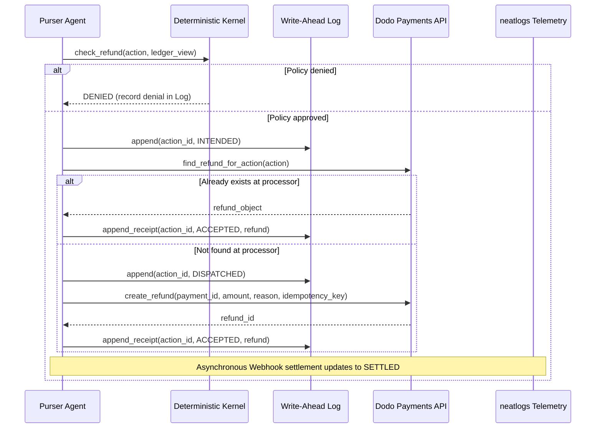

# PURSER ARCHITECTURE

## 1. Overview
Purser is an autonomous refund operations agent designed for solo and small-team SaaS founders selling through Dodo Payments. Purser clears refund queues overnight with strict write-ahead logging and crash recovery guarantees. Under any abrupt crash (including SIGKILL), every refund executes exactly once and reconciles against the payment processor ledger.

## 2. Core Decisions

### DECISIONS
- **LLM Provider & Models**: Google Gemini via the `google-genai` SDK.
  - **Planner Model (`PURSER_PLANNER_MODEL`)**: `gemini-2.5-pro` (chosen for deep multi-turn tool calling, complex policy evaluation, and strict adherence to guardrails).
  - **Writer Model (`PURSER_WRITER_MODEL`)**: `gemini-2.5-flash` (chosen for sub-second customer reply drafting and explanation synthesis).
  - **Telemetry Integration**: `genai.Client()` is initialized strictly AFTER `neatlogs.init()` and wrapped with `neatlogs.wrap(client)` to ensure complete OpenTelemetry span context propagation.
- **Database Architecture**: Supabase PostgreSQL session pooler accessed via `DATABASE_URL`. Row-level locks (`SELECT ... FOR UPDATE`) are used for distributed ticket leasing across concurrent workers.
- **Telemetry Topology**:
  - One trace per ticket root span (`WORKFLOW: purser.ticket`), batch grouped under `neatlogs.session.id`.
  - HTTP trace injection (`POST /v1/trace`) using `NEATLOGS_WRITE_KEY` for sworn Witness Statements to heal tail-truncated traces post-crash.
  - Project readback supported via `neatlogs-cli` device login or MCP server.

## 3. Money Protocol Sequence



## 4. Components

```
apps/
  web/                    Next.js landing + dashboard + customer status page + /verify
services/
  purser/
    agent/                planner loop, tools, Gemini integration (wrapped by neatlogs)
    kernel/               deterministic policy + invariant checks (P1 to P12)
    log/                  write-ahead Log, hash chain, Dead Reckoning
    processor/            Dodo client, reconciliation, webhook verification
    muster/               close-out reconciliation
    witness/              Witness Statement builder (neatlogs HTTP /v1/trace)
    provenance/           rule -> commit -> Entire checkpoint mapping
    telemetry/            neatlogs init, span helpers, attribute schema
    drills/               Storm Drill harness, fault injection
    verify/               offline verifier CLI
    api/                  FastAPI routes
policy/
  POLICY.md               founder's refund policy in plain English
  rules.py                deterministic rule functions with stable rule IDs
```
