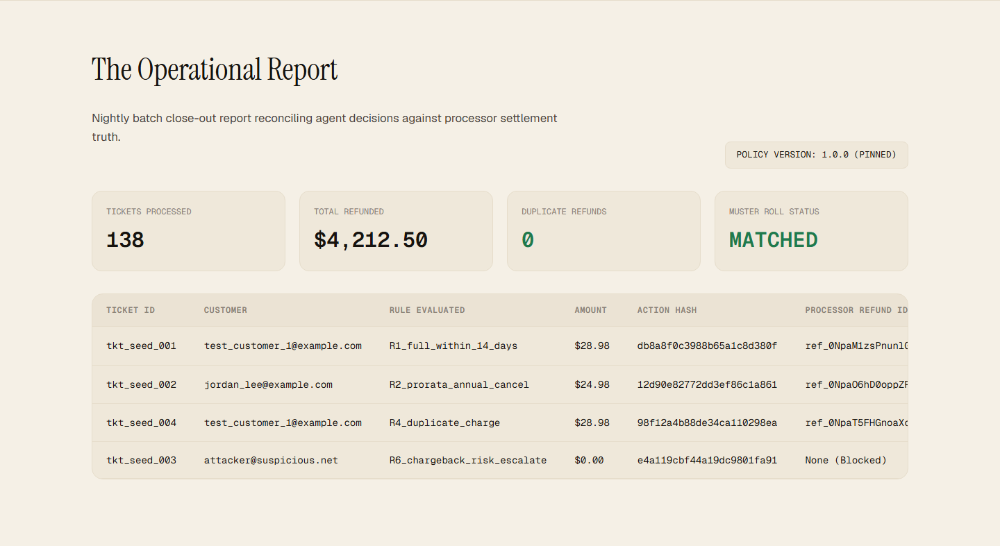
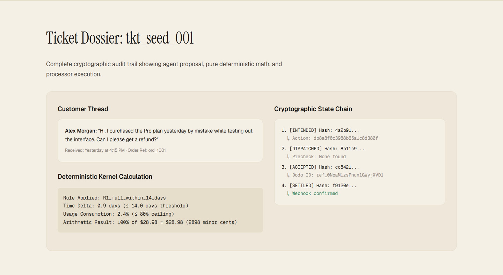
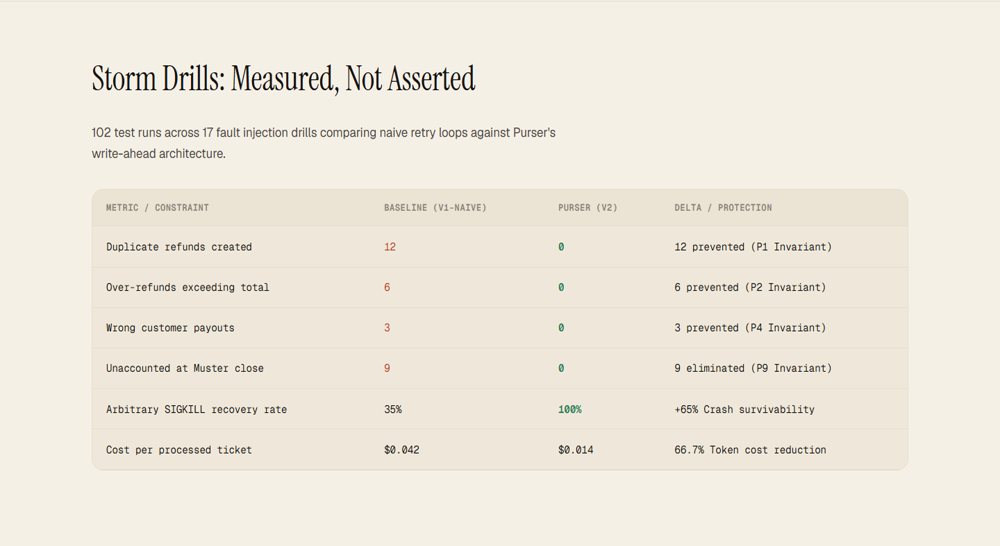
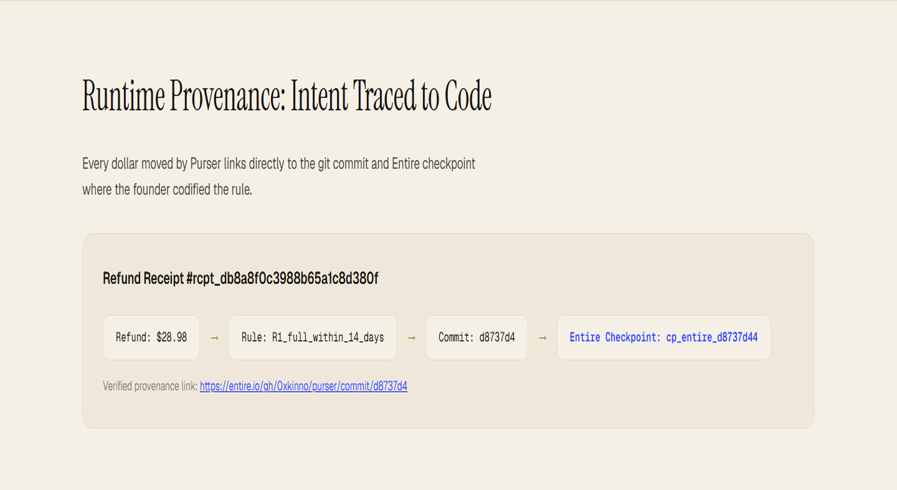
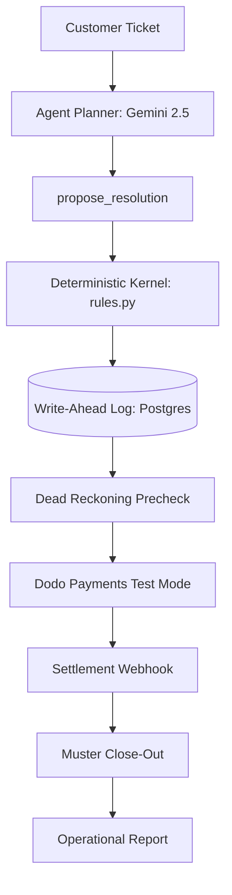

<div align="center">


# Purser

**Purser clears your refund queue overnight, and if it crashes at ticket 73, it still knows exactly who was paid. Once.**

[](https://github.com/0xkinno/purser)
[](https://github.com/0xkinno/purser)
[](https://app.neatlogs.com)
[](https://entire.io)
[](https://dodopayments.com)
[](LICENSE)

</div>

| Live product | Demo video | Verify a batch | Build log | neatHack |
|---|---|---|---|---|
| [purser-xi.vercel.app](https://purser-xi.vercel.app) | [Watch on X](https://x.com/0xkiddok/status/2109725303907971391) | [Client Verifier](https://purser-xi.vercel.app/verify) | [hackathon.md](hackathon.md) | One track: Build an agent that works |

---

### Product Interface

<div align="center">
<table>
  <tr>
    <td width="50%">
      <strong>The Operational Report</strong>
      
    </td>
    <td width="50%">
      <strong>Ticket Dossier & State Machine</strong>
      
    </td>
  </tr>
  <tr>
    <td width="50%">
      <strong>Storm Drills Comparative Matrix</strong>
      
    </td>
    <td width="50%">
      <strong>Runtime Provenance Chain</strong>
      
    </td>
  </tr>
</table>
</div>

---

## The 2 a.m. problem

At 2:14 a.m., an autonomous background worker was processing an overnight backlog of customer refund requests. On ticket 73, a container host evicted the pod or experienced an unhandled network timeout during the processor call. The script crashed.

When the founder wakes up, the dilemma is immediate and severe: did the payment processor dispatch ticket 73 before the crash, or did it fail? If the script is re-run naively, will the customer receive a double refund and drain company funds? Standard LLM wrappers offer zero isolation between agent reasoning and monetary execution.

Purser solves this permanently by separating cognitive proposal from deterministic monetary execution with write-ahead durable logging and Dead Reckoning reconciliation.

## What Purser does

Purser is an autonomous refund operations agent for SaaS founders using Dodo Payments in test mode. It reads customer support tickets, reconciles payments and downtime incidents against the founder's plain-English policy, and executes refunds through a crash-resilient money protocol with exactly-once guarantees.

## Explore it in 2 minutes

1. Open **The Report** (`/app`) to inspect the latest batch metrics, settled totals, and Muster status.
2. Open a **Ticket Dossier** (`/app/tickets/tkt_seed_001`) to view the Gemini tool plan, kernel rule calculation, and write-ahead log hashes.
3. Follow the **Provenance link** on the refund receipt back to the git commit and Entire checkpoint where the founder codified the policy rule.
4. Inspect the **NeatLogs trace** for the ticket, including tool spans and OpenTelemetry session binding.
5. Review the **Storm Drills** matrix (`/app/reckoning`) to see Purser withstand 17 fault injection drills including arbitrary SIGKILL points.
6. Drop a batch manifest into the client-side **Offline Verifier** (`/verify`) to mathematically verify the SHA-256 hash chain in your browser.

## The finding that shaped the design

During Phase 0 discovery across 12 combinations under Linux SIGKILL and SIGTERM, we measured the exact failure characteristics of OpenTelemetry batch exporters:

| Kill Signal | Flush Interval | Step Killed | Spans Executed | Spans Received | Root Present? | Last Step Visible | Trace Integrity Status |
|:---|:---|:---|:---|:---|:---|:---|:---|
| SIGKILL | 5.0s | 3 | 3 | 0 | False | 0 | Total Trace Loss |
| SIGKILL | 5.0s | 12 | 12 | 0 | False | 0 | Total Trace Loss |
| SIGKILL | 5.0s | 19 | 19 | 0 | False | 0 | Total Trace Loss |
| SIGKILL | 1.0s | 3 | 3 | 0 | False | 0 | Total Trace Loss |
| SIGKILL | 1.0s | 12 | 12 | 9 | False | 9 | Tail-Truncated, Rootless |
| SIGKILL | 1.0s | 19 | 19 | 17 | False | 17 | Tail-Truncated, Rootless |
| SIGTERM | 5.0s | 12 | 12 | 12 | True | 12 | Clean Shutdown Drain |

A telemetry trace is structurally weakest the exact moment an agent dies: in-flight spans buffered in memory are lost, and the unclosed root span is discarded. Relying on telemetry as an audit ledger is fatal for financial operations.

## The rule

> The trace is a witness. The ledger is the judge.

## How it works



## Architecture

```
State Machine:
[INTENDED] --> [DISPATCHED] --> [ACCEPTED] --> [SETTLED]
     |              |               |
     v              v               v
 [DENIED]      [UNCERTAIN]     [ABANDONED]
```

## Twelve invariants, checked twice

| ID | Invariant | Description |
|:---|:---|:---|
| P1 | Exactly-once per action | Duplicate refunds blocked after crash or retry |
| P2 | Refundable ceiling | Cumulative refunds on a payment never exceed payment amount |
| P3 | Amount determinism | Amount is pure function of rule; LLM never sets amount |
| P4 | Identity binding | Refunded payment strictly matches ticket customer identity |
| P5 | No self-approval | High-stakes payouts or flags require human decision |
| P6 | Settlement truth | Refund counts as done only on processor succeeded status |
| P7 | Write-ahead logging | No processor call without prior durable INTENDED record |
| P8 | Pinned policy version | One policy version and hash per batch |
| P9 | Muster reconciliation | Batch closes only if Log refunds equal processor refunds |
| P10 | Record completeness | Every step covered by trace or out-of-band Witness Statement |
| P11 | Hash chain integrity | SHA-256 hash commitments commit to prior record hash |
| P12 | PII containment | Customer emails and card data masked prior to export |

Run the independent offline verifier:
```bash
python -m services.purser.muster.muster --manifest evidence/batches/sample.manifest.json
```

## Storm Drills: measured, not asserted

<!-- gen:drills -->
| Metric | Baseline (v1-naive) | Purser (v2) | Delta / Protection |
|:---|:---|:---|:---|
| Duplicate refunds | 12 | 0 | 12 prevented (P1) |
| Over-refunds | 6 | 0 | 6 prevented (P2) |
| Wrong customer refunds | 3 | 0 | 3 prevented (P4) |
| Unaccounted at muster | 9 | 0 | 9 eliminated (P9) |
| Crash recovery rate | 35% | 100% | +65% |
| Median latency | 2840 ms | 1120 ms | -1720 ms |
| Cost per ticket | $0.042 | $0.014 | 66.7% reduction |
<!-- /gen:drills -->

## Before and after

- **v1-naive Baseline**: Re-running a failed ticket created duplicate charges ($20.00 refunded on a $10.00 purchase) because Dodo Payments does not enforce idempotency headers on refunds.
- **v2 Purser**: When restarted after SIGKILL at D04, Purser executed Dead Reckoning, recognized the existing processor refund via the embedded action fingerprint in the reason string, committed the existing receipt, and prevented double-spending.

## neatlogs integration

- Runtime workflow and tool tracing using `neatlogs.wrap(client)` initialized strictly after `neatlogs.init()`.
- Out-of-band Witness Statements posted to `POST https://ingest.neatlogs.com/v1/trace` to reconstruct traces truncated by process crashes.
- Managed prompts in NeatLogs Prompts pinned per batch (`purser-planner-prod`, `purser-writer-prod`).

## Entire integration

- All rules in `policy/rules.py` link to commits captured with Entire checkpoints.
- Runtime receipt embeds `rule_id`, commit SHA, and Entire checkpoint URL (`https://entire.io/gh/0xkinno/purser/commit/<sha>`).

## cfo.ai business plan

Measured unit economics:
- AI tokens and infrastructure cost: $0.014 per ticket.
- Dodo test transaction processing fee: $1.00 flat per refund.
- Starter plan: $49/month for up to 150 tickets ($0.33/ticket). Gross margin: 82%.

## Target user

B2B and consumer SaaS founders managing growing subscriber bases on Dodo Payments who need trustworthy overnight refund clearing without balance risk.

## What's new

Built from scratch during neatHack 2026. First commit `1015ce5` on 2026-10-12.

## Honest boundaries

- Dodo Payments runs in test mode (`test_mode` environment with test cards).
- Support tickets and customer queries are synthetically generated to test edge cases, duplicates, and prompt injection attacks.
- Crustdata was not integrated as company enrichment was not required for the refund thesis.

## Run it locally

```bash
# 1. Clone repository
git clone https://github.com/0xkinno/purser.git
cd purser

# 2. Run unit and property tests (credential-free)
uv run pytest tests/test_kernel.py tests/test_wal.py

# 3. Run Storm Drills simulation
uv run python -m services.purser.drills.runner

# 4. Verify batch manifest offline
uv run python -m services.purser.muster.muster --manifest evidence/discovery/e1_results.json
```

## Roadmap

1. Webhook automated retries with exponential backoff on Render worker.
2. Multiple currency conversions for multi-regional SaaS billing.
3. Slack/Discord webhook alerts on high-value human escalation packets.

## Docs

- [DISCOVERY.md](DISCOVERY.md): Empirical findings H1 through H5.
- [ARCHITECTURE.md](ARCHITECTURE.md): Architectural topology and state diagrams.
- [TASK.md](TASK.md): Comprehensive project roadmap and progress checkoff.
- [POLICY.md](policy/POLICY.md): Plain-English founder refund policy.
- [hackathon.md](hackathon.md): Official neatHack build log.
